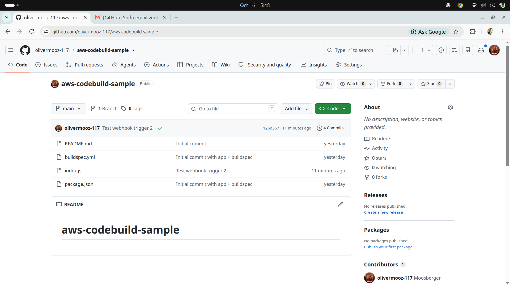
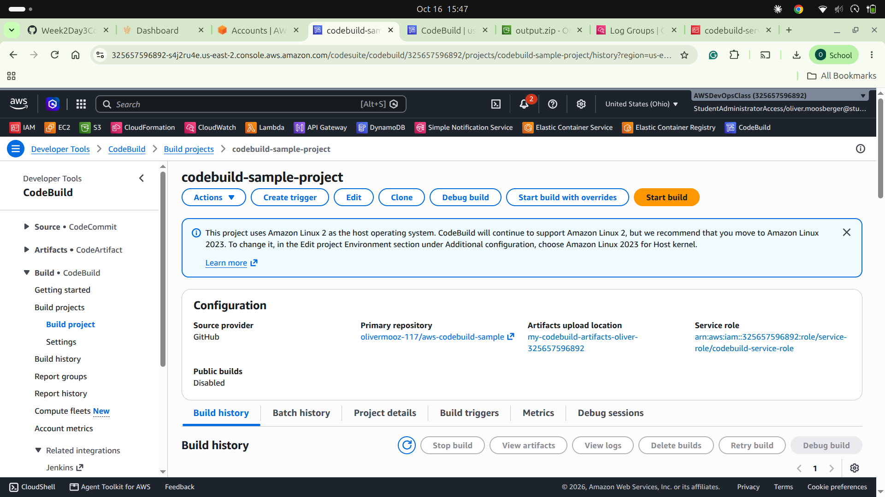
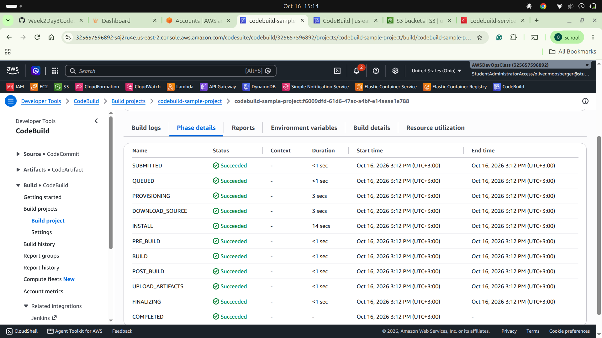
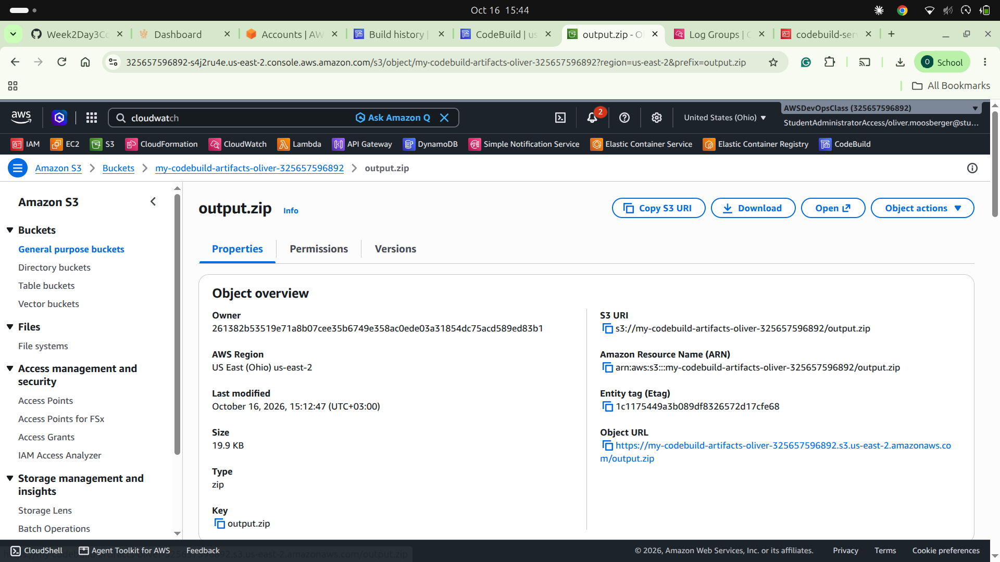
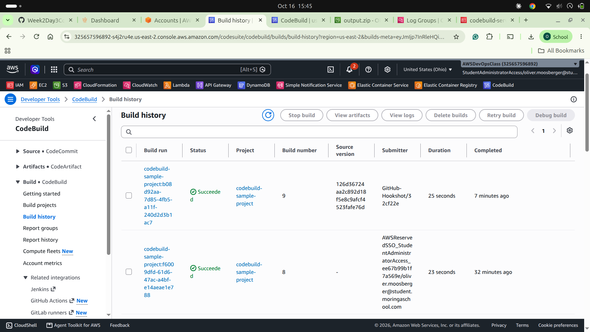

# aws-codebuild-sample

A small Continuous Integration pipeline on AWS: every push to GitHub triggers AWS CodeBuild, which installs dependencies, runs tests, builds the project and stores the result in S3.

**Flow:** GitHub push → webhook → CodeBuild (`buildspec.yml`) → `output.zip` in S3, with logs in CloudWatch.

## Stack
- GitHub (source control, webhook trigger)
- AWS CodeBuild (`aws/codebuild/standard`)
- Amazon S3 (build artifacts)
- Amazon CloudWatch Logs (build logs)
- IAM service role for CodeBuild

## How it works
`buildspec.yml` defines four phases: `install` (npm install), `pre_build` (npm test), `build` (npm run build) and `post_build`. All files are then packaged as `output.zip` and uploaded to S3.

## Screenshots

**1. Source repository** with the app and `buildspec.yml`

**2. CodeBuild project** configuration (source, environment, artifacts)

**3. Successful manual build**, with every phase passing

**4. Build artifact** `output.zip` stored in S3

**5. Automatic build** triggered by a GitHub push (submitter: GitHub-Hookshot)

## What I learned
- A commit and push is the trigger that starts a CI pipeline.
- `buildspec.yml` controls the build phases and the artifacts.
- CodeBuild needs an IAM service role, and a GitHub connection in the same region as the project.
- Webhooks make builds automatic on every push.

*The AWS resources were deleted after the lab to avoid charges.*